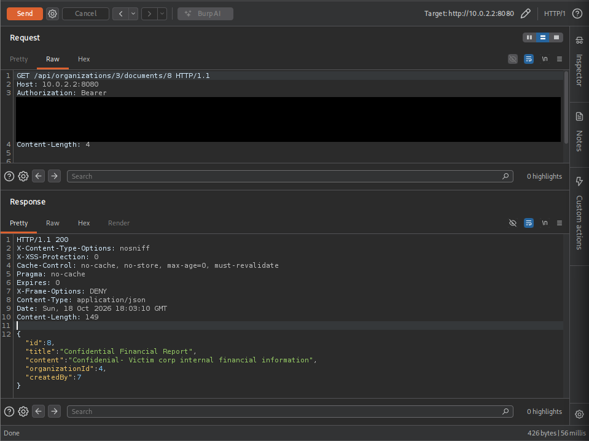
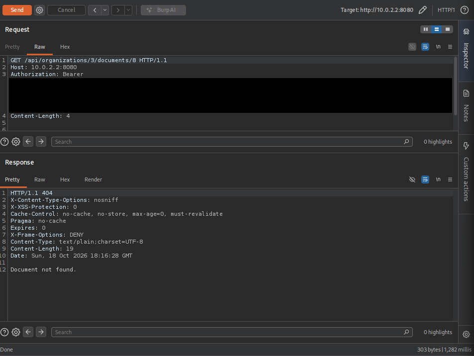

# Lab 01 — Cross-tenant BOLA in a document read

This case study records a completed, controlled local exercise against TenantGuard Lab's intentionally vulnerable `lab/bola` branch. It covers **OWASP API1:2023 Broken Object Level Authorization (BOLA)**, also commonly called an insecure direct object reference (IDOR). The affected endpoint is `GET /api/organizations/{organizationId}/documents/{documentId}`. No production system or real financial data was involved.

## Context and security invariant

The Spring Boot API authenticates users with RSA-signed JWTs. A membership assigns a user an `ADMIN`, `EDITOR`, or `VIEWER` role **within one organization**; documents also belong to one organization. Reading a document requires at least `VIEWER` membership in *that document's organization*. A role in another organization does not transfer to it.

The request contains two independently meaningful identifiers: `organizationId` names the tenant context and `documentId` names a document. The server must verify that the document returned for that ID belongs to the authorized tenant. The attacker in this exercise had a valid account and a valid JWT, plus membership in their own organization, but no membership in the victim organization. They knew the target document ID; the exercise did not require guessing a token or escalating their role.

## What went wrong

In `lab/bola`, `DocumentService.getDocumentById()` first checks the requester's `VIEWER` access to the **URL organization**, then looks up the document by its global ID:

```java
membershipService.requireRole(userId, organizationId, Role.VIEWER);
return documentRepository.findById(documentId)
        .orElseThrow(DocumentNotFoundException::new);
```

The check confirms the user's membership in one organization, but the subsequent query does not bind the returned object to that organization. An attacker can therefore put their own organization in the URL while supplying a document ID from another tenant. This is an **object-level authorization failure**, not an authentication failure: the JWT is valid and the user may legitimately call the read endpoint, but they are not authorized for the specific document returned. It is also not a failure of the role hierarchy; even `ADMIN` in one tenant grants no rights in another.

## Historical manual observation

The exercise was performed locally with Kali Linux and Burp Suite Repeater. In that run, `pentester_test` was an `ADMIN` in organization `3` (Pentest Corp), with no membership in organization `4` (Victim Corp). Document `8`, titled `Confidential Financial Report`, belonged to organization `4` and contained simulated financial information. These IDs describe **one local database state**, not guaranteed IDs for another reader.

The attacker used their own JWT and sent this request (token redacted):

```http
GET /api/organizations/3/documents/8 HTTP/1.1
Host: 127.0.0.1:8080
Authorization: Bearer <ATTACKER_JWT>
```

| Implementation | Observed response | Meaning |
| --- | --- | --- |
| `lab/bola` | `200 OK`; JSON identified document `8` with `organizationId: 4` and returned its simulated content | Cross-tenant disclosure despite authorization only for organization `3` |
| `main` | `404 Not Found`; `Document not found.` | The document was not found *within the authorized organization* |

These are historical observations from the controlled exercise, not results freshly reproduced for this write-up. The `404` does not mean document `8` is absent globally; it means it is not a document of organization `3`.

## Root cause and secure reference

The vulnerable branch changed one repository call in `DocumentService.getDocumentById()`. The secure implementation on `main` keeps the membership check **and** constrains the lookup by both identifiers:

```diff
 membershipService.requireRole(userId, organizationId, Role.VIEWER);
-return documentRepository.findById(documentId)
+return documentRepository.findByOrganization_IdAndId(organizationId, documentId)
         .orElseThrow(DocumentNotFoundException::new);
```

The organization ID is client-supplied, so authorizing that ID alone is not enough. In the secure query, the document's stored organization relationship must match it before the document can be returned. The controller only serializes a document after this service lookup succeeds. The repository also uses organization-scoped lookups for document updates and deletes; this lab concerns the single-document **read** path.

## Regression evidence

On `main`, `ApiAuthorizationTest.documentRoutesEnforceRolesAndTenantScope()` creates two organizations and a document in the first. It makes a `GET` request with a user who is authorized in the **second** organization, using the second organization's ID and the first organization's document ID, and expects `404`. The test also checks unauthenticated access, role restrictions, and permitted document operations. `DocumentServiceTest.viewerCanReadOnlyDocumentsInTheirOrganization()` verifies use of the scoped repository method; `documentInAnotherOrganizationIsNotFound()` checks the service's not-found behavior.

The existing authorization test passed on the secure implementation. On `lab/bola`, the cross-tenant assertion was observed to fail with `Expected: 404, Actual: 200`. This is a regression signal for tenant isolation, not evidence that every authorization path was vulnerable. Tests requiring the full Spring context also need the development PostgreSQL connection and `DB_PASSWORD` available to Maven; Docker Compose reads `.env` for its containers but does not export it into the caller's shell. No tests were rerun while preparing this document.

## Reproducing in an isolated environment

Use only fictitious data and local credentials. Follow the existing [lab setup guide](../../../LAB.md) to prepare ignored `.env`, `.env.lab`, and RSA key files, and to start the lab with:

```powershell
docker compose --env-file .env --env-file .env.lab -f compose.lab.yaml up -d --build
```

Stop any IntelliJ-run API already using port `8080` first. The lab Compose project has its own PostgreSQL volume and publishes the API only on `127.0.0.1:8080`. Its automatic seed creates Acme and Globex, not the historical Pentest/Victim scenario: to repeat that exact scenario, create two separate organizations, give the attacker membership only in one, and place a **fictitious** document in the other. Record the IDs actually assigned by your database. Log in as the attacker via `POST /api/auth/login`, then send the attacker JWT to Burp Repeater with the attacker's organization ID in the route and the other organization's document ID. Never save a live JWT in the repository.

Run the two branches **separately** against the isolated lab. Rebuilding the API image after switching branches is necessary for the container to execute that branch's code; confirm which branch and container are active before interpreting a response. Do not run another stack on occupied ports or remove a database volume to switch implementations. The expected comparison is the historically observed `200` on `lab/bola` versus `404` on `main`; the branch with the deliberate weakness must remain isolated and must not be merged into `main`.

## Evidence and engineering lessons

The Burp Repeater captures below show the same authenticated request against each branch. The Bearer JWT is redacted in both images.

**Vulnerable `lab/bola` — `200 OK`:** [open the full-size capture](evidence/bola-vulnerable-200.png).



**Secure `main` — `404 Not Found`:** [open the full-size capture](evidence/bola-secure-404.png).



The central lesson is to make tenant identity part of every object lookup, not merely a preliminary role check. A valid token and a valid role establish *who* may act in a tenant; they do not establish that a separately requested object belongs to that tenant. Scoped queries, explicit permission checks, and cross-tenant regression tests reinforce one another.

**Stack and tools:** Java 21, Spring Boot, Spring Security, RSA-signed JWT, PostgreSQL 17, Spring Data JPA/Hibernate, Flyway, Maven, Docker Compose, JUnit/MockMvc, Kali Linux, and Burp Suite Repeater.

**Reference:** [OWASP API1:2023 — Broken Object Level Authorization](https://api-security.owasp.org/editions/2023/en/0xa1-broken-object-level-authorization/).
