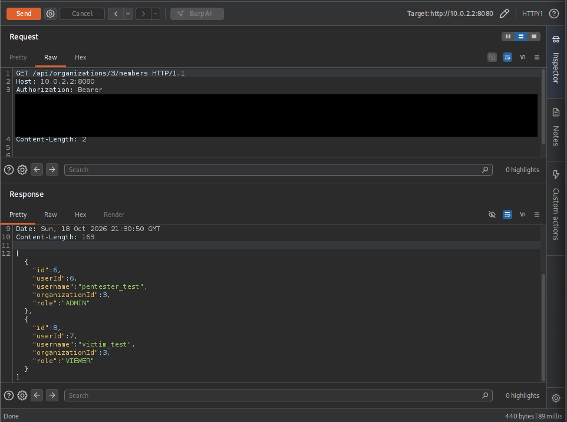
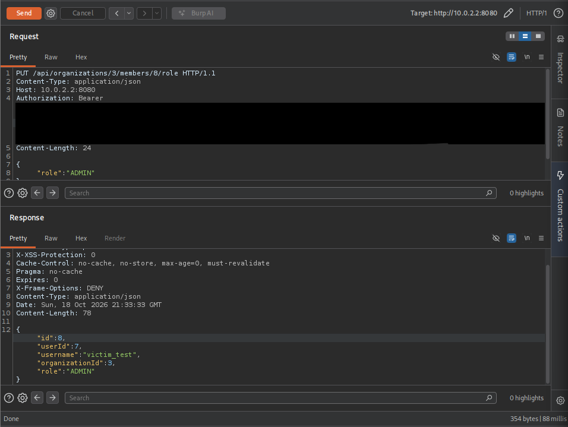
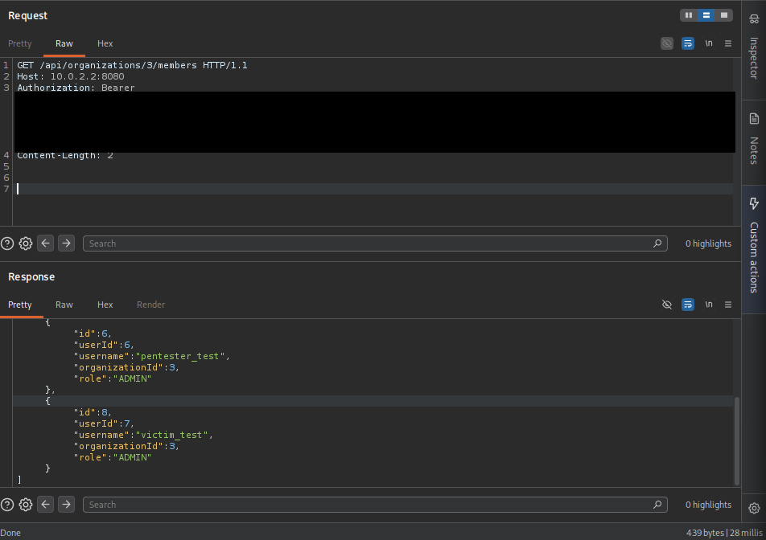

# Lab 02 — Vertical privilege escalation through role management

This case study records a completed, controlled local exercise against TenantGuard Lab's intentionally vulnerable [`lab/bfla`](https://github.com/raulperezmoreno71/tenantguard-lab/tree/lab/bfla) branch. It illustrates **OWASP API5:2023 Broken Function Level Authorization (BFLA)** at `PUT /api/organizations/{organizationId}/members/{memberId}/role`. The objective is to distinguish a valid authenticated request from permission to execute an administrative function, then verify the boundary with a regression test. No production system or real customer data was involved.

## Context and security invariant

The API authenticates users with RSA-signed JWTs. A membership grants a role within one organization: `VIEWER` can read documents, `EDITOR` also has document write permissions, and `ADMIN` can manage memberships. Roles are hierarchical, but none is global across organizations. Changing a member's role is an **ADMIN-only function**. A valid JWT and `VIEWER` membership do not authorize a role change, even when the target is the caller's own membership.

The attacker in this exercise controlled a legitimate `VIEWER` account and its JWT and knew their own membership ID. They did not need an administrator token. The vulnerable service still scoped the target membership to the organization in the URL, so this case demonstrates **vertical escalation within an organization**, not a cross-tenant membership bypass.

## What went wrong

`MembershipController.updateRole()` passes the JWT subject, organization ID, membership ID, and requested role to `MembershipService.updateRole()`. The vulnerable branch lowered the function's required role from `ADMIN` to `VIEWER`:

```diff
 lockOrganization(organizationId);
-requireRole(adminId, organizationId, Role.ADMIN);  // main
+requireRole(adminId, organizationId, Role.VIEWER); // lab/bfla
 Membership member = findMember(organizationId, memberId);
 ensureAdministratorRemains(organizationId, member, role);
 member.setRole(role);
```

Because every organization member satisfies the `VIEWER` threshold, a viewer can invoke this administrative operation. The `memberId` lookup remains organization-scoped, and the last-administrator safeguard remains present, but neither stops a viewer from promoting themselves. This is **function-level** authorization failure: the viewer is allowed into a function that should be reserved for administrators. The role change then gives the user real administrative capabilities on subsequent requests.

## Historical manual observation

Burp Suite Repeater was used against the isolated local lab. In that database state, organization `3` contained `pentester_test` (`userId: 6`, membership `6`, `ADMIN`) and `victim_test` (`userId: 7`, membership `8`, initially `VIEWER`). These IDs belong to one local run; use the IDs in your own environment.

1. **Initial state.** With `pentester_test`'s JWT, `GET /api/organizations/3/members` returned `200 OK` and showed membership `8` as `VIEWER`.
2. **Role change.** With only `victim_test`'s JWT, the attacker sent:

   ```http
   PUT /api/organizations/3/members/8/role HTTP/1.1
   Authorization: Bearer <VIEWER_JWT>
   Content-Type: application/json

   {"role":"ADMIN"}
   ```

   On `lab/bfla`, the observed response was `200 OK`:

   ```json
   {"id":8,"userId":7,"username":"victim_test","organizationId":3,"role":"ADMIN"}
   ```

3. **Impact confirmation.** Without changing JWTs, `victim_test` then requested `GET /api/organizations/3/members` and received `200 OK`; the response showed both users as `ADMIN`. `MembershipService.getMembers()` still requires `Role.ADMIN`, so this follow-up demonstrates that the promotion changed effective authorization, not merely the response body of the update call.

These are historical observations from the controlled exercise, not requests replayed for this write-up. The direct result was unauthorized role modification and access to the admin-only member list. A newly promoted admin could also invoke other admin-only membership functions in that organization; those additional actions were **not** demonstrated by these captures.

## Secure reference and regression evidence

On `main`, `MembershipService.updateRole()` retains `requireRole(adminId, organizationId, Role.ADMIN)`. A `VIEWER` attempting the same role update should receive `403 Forbidden` and remain a `VIEWER`. `MembershipService.getMembers()` also requires `ADMIN`, so an unpromoted viewer should not be able to list members.

The existing `ApiAuthorizationTest.viewerCannotPromoteThemselvesToAdmin()` creates an administrator and a viewer in one organization, sends a self-promotion `PUT` as the viewer, expects `403`, and asserts that the stored membership is still `VIEWER`. It is an HTTP-level authorization regression test using MockMvc and a test JWT; it does not depend on fixed IDs from the manual exercise.

| Branch | Test evidence |
| --- | --- |
| `lab/bfla` | Previously observed failure: `Status expected:<403> but was:<200>`. This is intentional evidence that the vulnerable branch violates the invariant. |
| `main` | The targeted test was run for this write-up against a disposable PostgreSQL 17 container: **1 test, 0 failures, 0 errors**. Flyway applied the schema; the temporary container used no persistent volume and was stopped afterward. |

This test verifies the denied self-promotion path on `main`; it does not by itself prove that every administrative endpoint is correctly protected.

## Reproducing in an isolated environment

Use only local fictitious accounts. Follow the [lab setup guide](../../../LAB.md) for ignored `.env`, `.env.lab`, and RSA keys. Stop any IntelliJ-run API already using port `8080`, and start the Compose lab on the branch under examination:

```powershell
docker compose --env-file .env --env-file .env.lab -f compose.lab.yaml up -d --build
```

The lab seed provides an `ADMIN` (`alice`) and a `VIEWER` (`charlie`) in Acme Corp; alternatively, create your own pair as in the historical exercise. Log in through `POST /api/auth/login` to obtain separate JWTs. As the admin, call `GET /api/organizations/{organizationId}/members` to record the viewer's **membership ID** (`id`), which is not the user's `userId`. In Burp Repeater, send the viewer's JWT in the role-update request shown above, substituting your actual organization and membership IDs, then attempt the admin-only member-list request with that same viewer JWT. Never commit a JWT or real password.

Run `lab/bfla` and `main` **separately** and rebuild the API image after switching branches so the container uses the selected implementation. Switching branches does **not** reset the database: after a successful promotion on `lab/bfla`, the account remains an admin when you switch to `main`. Restore a `VIEWER` starting state before comparing the secure response; the explicit lab-only reset procedure in [LAB.md](../../../LAB.md#reset-only-the-laboratory-scenario) can recreate the seed, but it deletes changes in the lab volume and requires confirmation. Do not remove the development volume or use `docker compose down -v`.

## Burp evidence and engineering lessons

The three captures below show the initial role, the successful self-promotion on `lab/bfla`, and the subsequent admin-only member-list response. Bearer JWT values are redacted.

**Before — `victim_test` is a viewer:** [open the full-size capture](evidence/01-viewer-before.png).



**Escalation — viewer changes their role to ADMIN:** [open the full-size capture](evidence/02-privilege-escalation-200.png).



**After — the same user accesses the admin-only member list:** [open the full-size capture](evidence/03-admin-access-200.png).



The essential control is a role check at the sensitive function, not merely authentication or membership in the organization. Keeping the `ADMIN` requirement in `updateRole()`, scoping membership lookups to the organization, preserving the last-admin safeguard, and testing a low-privilege caller provide complementary protections. The regression test makes this specific privilege boundary reviewable when the service changes.

**Stack and tools:** Java 21, Spring Boot, Spring Security, RSA-signed JWT, PostgreSQL 17, Spring Data JPA/Hibernate, Flyway, Maven, Docker Compose, JUnit/MockMvc, and Burp Suite Repeater.

**Reference:** [OWASP API5:2023 — Broken Function Level Authorization](https://api-security.owasp.org/editions/2023/en/0xa5-broken-function-level-authorization/).
